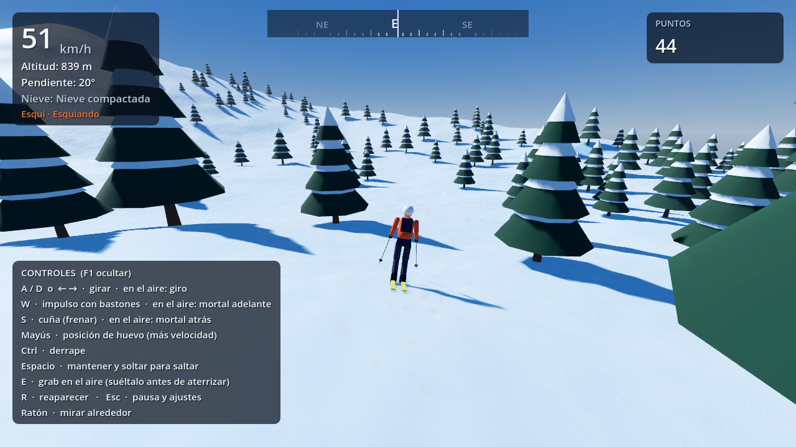

# Vertiente — Macizo del Albor

Juego original de deportes de invierno en mundo abierto para **Godot 4.3+**: esquí (fase 1), snowboard, parapente y wingsuit en un macizo alpino generado por código. Sin recursos externos: relieve, árboles, personaje, materiales y sonido se crean de forma procedural.

## Documentación

| Documento | Para qué sirve |
|---|---|
| [Guía para no programadores](docs/GUIA_NO_PROGRAMADORES.md) | Instalar Godot, abrir el proyecto, jugar y resolver errores típicos |
| [Diseño técnico](docs/DISENO_TECNICO.md) | Arquitectura, decisiones físicas, terreno, rendimiento y plan por fases |
| [Fase 1](docs/FASE_1.md) | Archivos, cómo probarla, verificación, qué funciona, qué falta y errores conocidos |

## Inicio rápido

1. Descarga Godot 4.3 o superior desde <https://godotengine.org/download> (versión normal, no .NET).
2. Descarga este repositorio como ZIP y descomprímelo.
3. En Godot: **Importar** → selecciona `game/project.godot` → **Importar y editar**.
4. Pulsa **▶** (F5).

## Estado

| Fase | Contenido | Estado |
|---|---|---|
| 1 | Terreno por chunks, esquí, cámara, shader de nieve, HUD | Cerrada |
| 2 | Snowboard, cambio de disciplina, huellas | Siguiente |
| 3–9 | Clima y día/noche, mundo y misiones, parapente, wingsuit, avalanchas, IA, modo foto y pulido | Pendientes |
