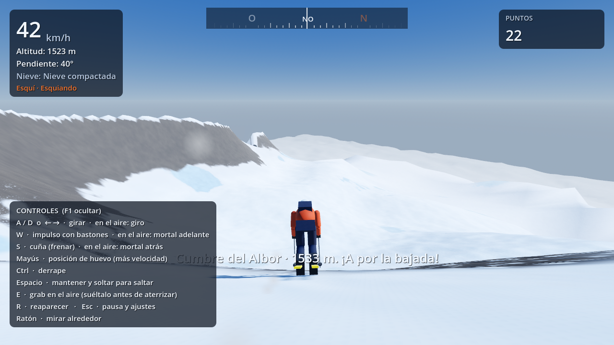
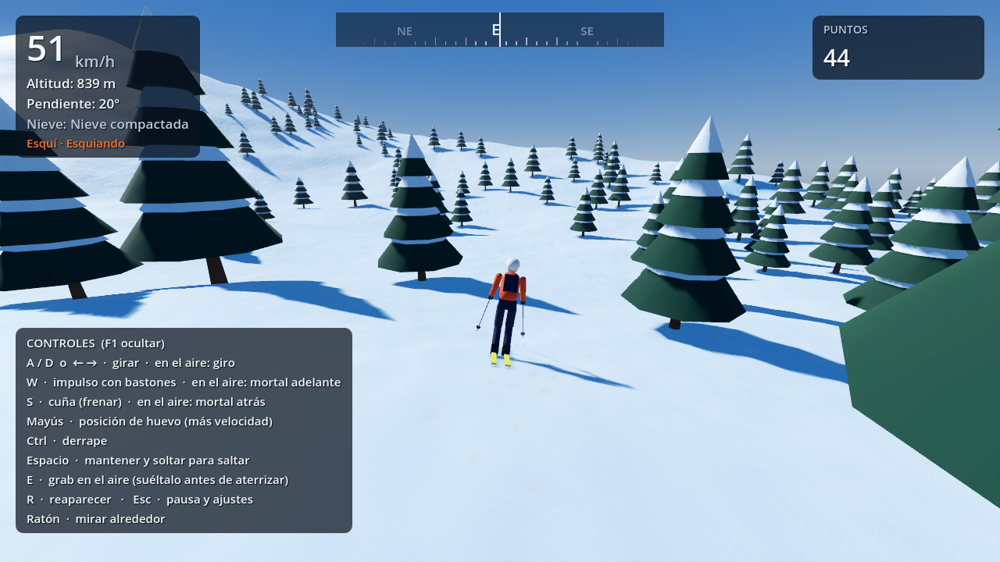

# Fase 1 — Versión base jugable

**Estado: cerrada.** El proyecto se abre y se juega sin errores en Godot 4.3.

*Capturas reales del juego (renderizador Compatibility por software; en Forward+ con tarjeta gráfica se ve con más calidad de sombras y niebla).*

---

## 1. Archivos de la fase

Todos los archivos son nuevos y están completos en la carpeta `game/` del repositorio.

| Archivo | Líneas | Función |
|---|---|---|
| `project.godot` | 152 | Configuración: autoloads, ventana, renderizador Forward+, mapa de controles (teclado, ratón y mando) |
| `main.tscn` | 6 | Escena principal (un único nodo con `main.gd`) |
| `main.gd` | 82 | Monta el mundo por código y espera a que haya suelo antes de soltar al jugador |
| `icon.svg` | 14 | Icono propio |
| `autoload/event_bus.gd` | 23 | Señales globales |
| `autoload/game_state.gd` | 118 | Ajustes, preajustes de calidad, progresión |
| `autoload/save_system.gd` | 82 | Guardado automático en JSON |
| `autoload/audio_bus.gd` | 175 | Viento y siseo procedurales, impactos, campanilla de truco |
| `world/terrain_sampler.gd` | 140 | Función de altura, superficies y probabilidad de árboles |
| `world/terrain_chunk_builder.gd` | 202 | Datos de malla, faldones, colisión y árboles (se ejecuta en hilos) |
| `world/terrain_chunk.gd` | 106 | Nodo de chunk: malla, `HeightMapShape3D`, `MultiMesh` de abetos |
| `world/terrain_manager.gd` | 290 | LOD, colas, hilos, horizonte lejano, punto de salida |
| `world/vegetation_factory.gd` | 66 | Abeto nevado de primitivas |
| `world/atmosphere.gd` | 80 | Cielo, sol, sombras en cascada, niebla, bloom, color |
| `world/shaders/terrain.gdshader` | 135 | Mezcla polvo/compactada/hielo/roca, normales detalladas, destellos |
| `player/discipline.gd` | 41 | Clase base de las disciplinas |
| `player/ski_discipline.gd` | 403 | Física del esquí, trucos, aterrizajes, caídas |
| `player/player_controller.gd` | 219 | Cuerpo del jugador, superficie, partículas, reaparición |
| `player/character_model.gd` | 253 | Esquiador de primitivas con animación procedural |
| `camera/camera_rig.gd` | 105 | Cámara con seguimiento suave, colisión, FOV dinámico |
| `ui/ui_theme.gd` | 69 | Tema visual común |
| `ui/compass.gd` | 50 | Brújula dibujada a mano |
| `ui/hud.gd` | 231 | Velocidad, altitud, pendiente, nieve, puntos, avisos, ayuda, carga |
| `ui/pause_menu.gd` | 162 | Pausa con calidad, volumen, ratón, FPS, guardar y salir |
| `tools/generar_controles.gd` | 61 | Regenera el mapa de controles en `project.godot` |
| `tests/prueba_fase1.gd` | 102 | Prueba automática de jugabilidad |
| `tests/captura_pantalla.gd` | 47 | Capturas automáticas |

No se necesitan archivos `.tres`: todos los recursos (materiales, mallas, cielo, entorno, tema) se crean por código.

---

## 2. Cómo probar la fase

1. Abre el proyecto siguiendo la [guía para no programadores](GUIA_NO_PROGRAMADORES.md) y pulsa **▶** (F5).
2. Comprueba que aparece la pantalla **VERTIENTE** con una barra de carga y, en pocos segundos, el esquiador cerca de la cumbre con el mensaje *"Cumbre del Albor · … m"*.
3. Mantén **Mayús** (huevo): la velocidad del marcador debe subir de forma progresiva.
4. Alterna **A** y **D**: el esquiador se inclina hacia dentro de la curva y la nieve salta de los esquís.
5. Pulsa **Ctrl** mientras giras: el giro es más cerrado y frenas (derrape).
6. Pulsa **S**: frenas en cuña hasta detenerte.
7. Mantén **Espacio** un segundo y suéltalo: saltas. En el aire mantén **A** medio segundo y suelta: al aterrizar debe aparecer *"Giro 180 + Switch"* con puntos.
8. Prueba un mortal: salta y mantén **W**. Si aterrizas a medio girar, verás *"¡Caída!"* y reaparecerás a los 2–3 segundos.
9. Baja hasta el bosque (por debajo de ~1150 m) y choca a propósito con un árbol: caída por *"Choque contra un árbol"*.
10. Pulsa **Esc**: cambia la **Calidad gráfica** entre Bajo, Medio y Alto; el horizonte y los árboles se regeneran sin cortes.
11. Activa **Mostrar FPS** y comprueba que estás en torno a 60.
12. Pulsa **Guardar y salir**, vuelve a ejecutar: los puntos y la calidad elegida se conservan.

---

## 3. Verificación realizada antes de cerrar la fase

| Comprobación | Resultado |
|---|---|
| Ejecución *headless* de 900 fotogramas | Sin errores de script |
| Prueba automática de 45 s (huevo, curvas, dos saltos con giro, calidad Alta→Baja, pausa, reaparición) | 0 caídas injustas, 0 fotogramas bajo el suelo, 2 trucos puntuados, velocidad máx. 76 km/h, chunks 197 → 290 → 122 al cambiar la calidad |
| Capturas con renderizador real (Compatibility, Mesa) | Shader compila, caras bien orientadas, bosque, sombras y HUD correctos |
| Fugas de memoria al salir (`--verbose`) | Ninguna propia del juego. El motor puede mostrar de forma ocasional un aviso sobre `AudioStreamGeneratorPlayback` al cerrar (ver errores conocidos) |
| Distribución de pendientes del relieve | 6 % < 10°, 70 % entre 10° y 40°, 1,6 % > 60° |

Errores encontrados y corregidos durante la revisión:

1. **Relieve demasiado escarpado** (26 % del terreno > 60°): recalibradas amplitudes y radio del macizo.
2. **Salida en la cima exacta** con pendiente nula (el esquiador no se movía): ahora desciende por la línea de máxima pendiente hasta una ladera ≥ 14°.
3. **Pérdida de velocidad por `move_and_slide`** (anulaba la componente vertical en cada fotograma): velocidad reproyectada sobre el plano del suelo.
4. **Creación de energía en las curvas** (hasta 198 km/h): el agarre del canto ahora rota la velocidad sin aumentar su módulo.
5. **Caídas injustas** al girar sobre un bache: retardo de inicio de truco y autoalineación en el aire.
6. **Partículas cuadradas grises, muaré en la roca, franja oscura en el horizonte, ayuda solapada con mensajes**: corregidos en partículas, shader, cielo y HUD.
7. **Reproducción del generador de audio retenida al cerrar**: el audio se detiene antes de salir (mitigado; ver errores conocidos).

---

## 4. Qué funciona

- Macizo de ~14 × 14 km con cumbre a ~1540 m, crestas, valles tallados, bosques y horizonte lejano.
- Carga progresiva por hilos y LOD sin tirones apreciables.
- Esquí completo: carving, derrape, cuña, impulso con bastones, posición de huevo, saltos cargados, giros y mortales, grab, aterrizaje switch, caídas y reaparición.
- Física dependiente de la nieve (polvo, compactada, hielo, roca).
- Cámara con seguimiento, colisión, órbita con ratón/stick y retorno automático.
- HUD: velocidad, altitud, pendiente, tipo de nieve, estado, brújula, puntos, avisos de trucos y caídas, ayuda de controles.
- Menú de pausa con calidad, volumen, sensibilidad, inversión del eje Y y FPS.
- Guardado automático de ajustes y progresión.
- Sonido procedural de viento y deslizamiento; impactos y campanilla de truco.
- Teclado, ratón y mando.

## 5. Qué falta (fases siguientes)

- Snowboard, parapente y wingsuit (la tecla Tab ya está reservada para cambiar de disciplina).
- Huellas persistentes, clima, ciclo día/noche, avalanchas.
- Refugios, viaje rápido, mapa y minimapa, desafíos, niveles, equipamiento.
- IA, fantasmas, modo foto, repetición, menú inicial, remapeo de controles y música.

## 6. Errores conocidos y limitaciones

| Limitación | Impacto | Previsión |
|---|---|---|
| Forward+ no se ha podido renderizar en el entorno de pruebas (sin GPU Vulkan); sí Compatibility y toda la lógica | Bajo: el shader solo usa funciones comunes a ambos | Si aparece algún aviso en Forward+, cambiar a Compatibility (ver guía) e informar |
| La cámara puede atravesar el follaje de los abetos (solo el tronco tiene colisión) | Estético | Fase 9: atenuar árboles cercanos a la cámara |
| Godot 4.3 no tiene interpolación de física en 3D: en monitores de más de 60 Hz puede notarse una ligera vibración | Leve | Opción de limitar a 60 FPS en los ajustes (fase 9) |
| Paredes de más de 62° actúan como muro: chocar a más de 40 km/h provoca caída | Intencionado | — |
| La caída es una animación de volteo, no un ragdoll físico | Estético | Fase 7 |
| El remapeo de controles aún no está en el menú | Se puede cambiar en Proyecto → Configuración del proyecto → Mapa de entrada | Fase 9 |
| Al cerrar, la consola puede mostrar ocasionalmente *"ObjectDB instances leaked at exit"* (reproducción del generador de audio que el motor libera tarde) | Ninguno: solo un mensaje en la consola del editor | Se revisará con versiones posteriores de Godot |
| En el límite entre el terreno detallado y el lejano puede verse un pequeño escalón a gran distancia | Leve, oculto por la niebla | Ajuste fino en fase 9 |

---

## 7. Por dónde continuar

**Fase 2 — Snowboard**: crear `player/snowboard_discipline.gd` heredando de `Discipline`, añadir al modelo una tabla y postura lateral, implementar el cambio de disciplina con la acción `switch_discipline` (Tab) y una transición animada, y las huellas persistentes mediante una textura dinámica proyectada sobre el terreno.
